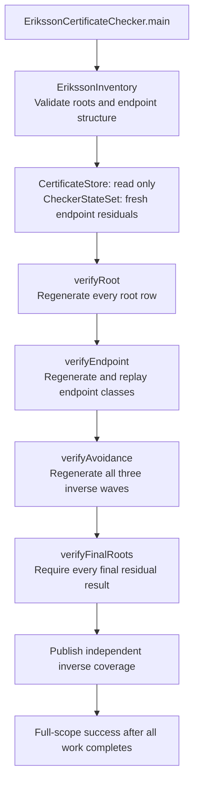
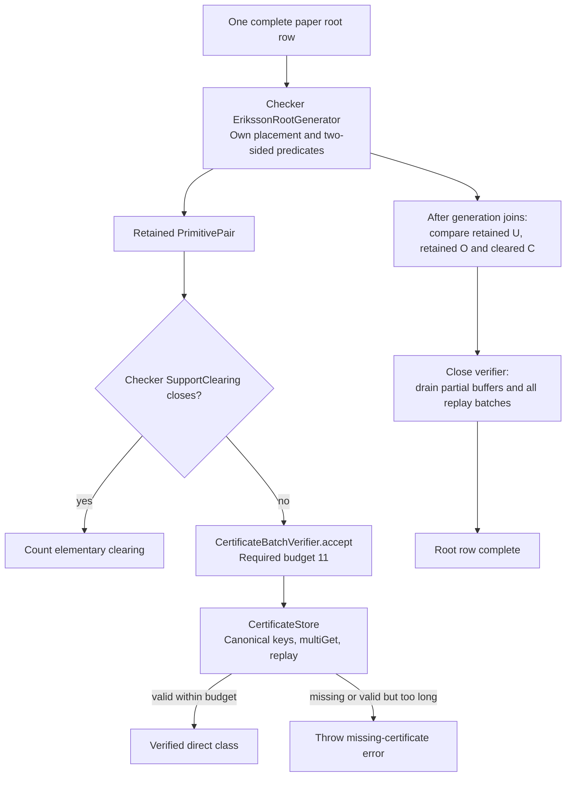
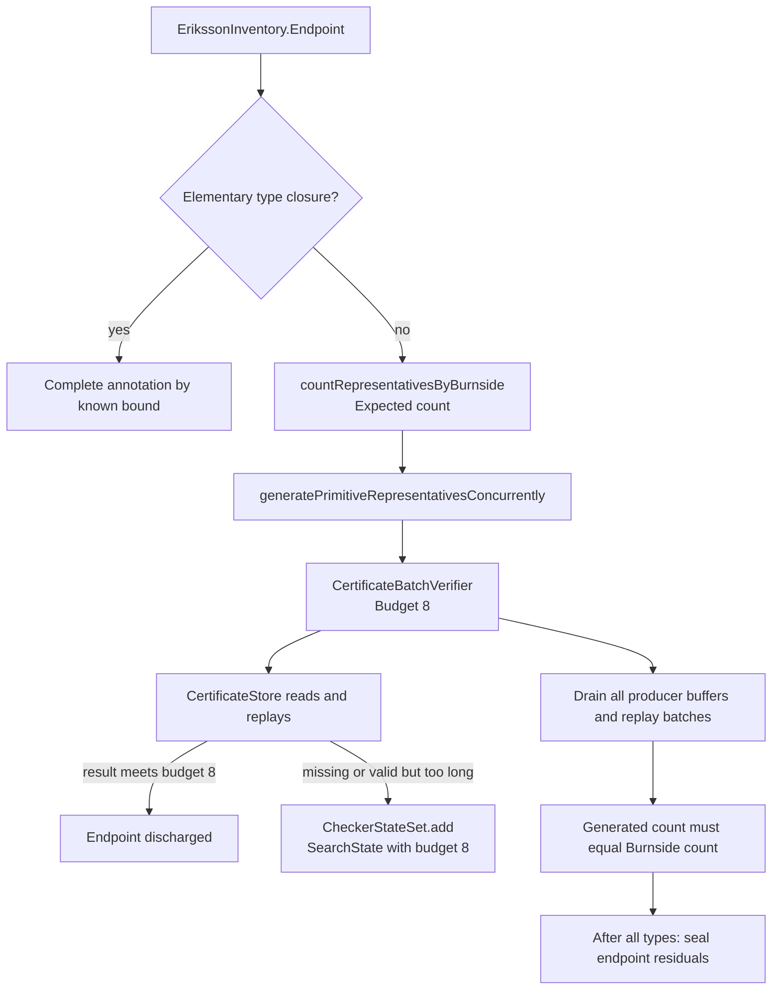
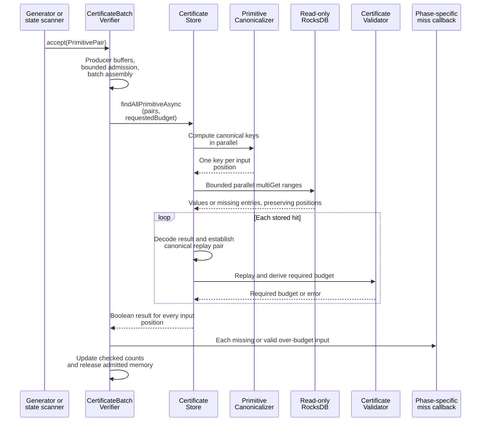
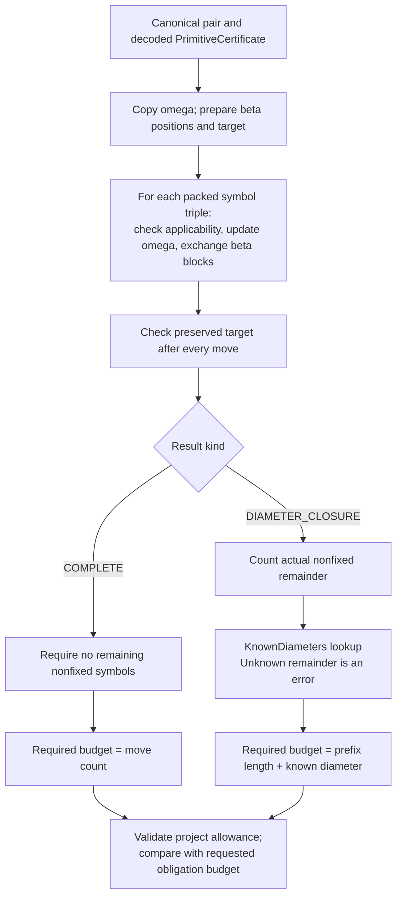
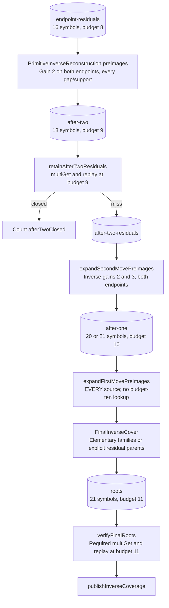
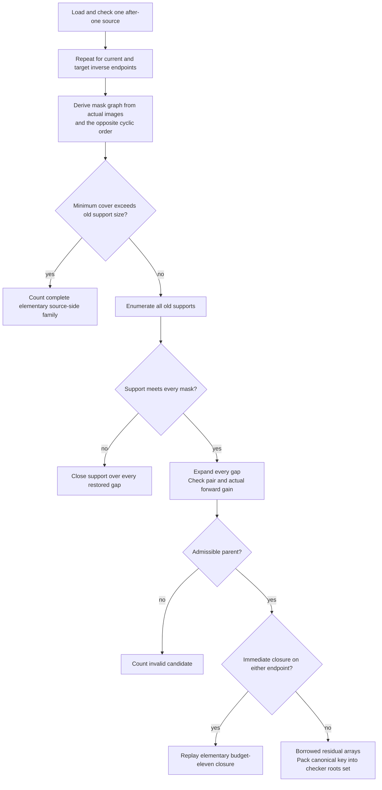
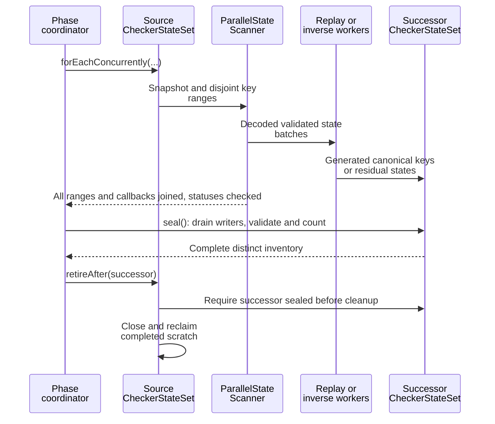

# Checker: component interactions during execution

The checker regenerates obligations and reads intrinsic results from the
certificate database. It does not search for witnesses. This walkthrough follows
the complete production check, assuming familiarity with the mathematics. See
the [visual overview](EXECUTION.md) and
[emitter walkthrough](EMITTER_EXECUTION.md) for the connecting artifacts.

## 1. The coordinator creates an independent execution

[CertificateChecker](../checker/src/main/java/br/unb/cic/td20/CertificateChecker.java)
forwards to
[ErikssonCertificateChecker](../checker/src/main/java/br/unb/cic/td20/verification/ErikssonCertificateChecker.java).
This coordinator loads the root inventory, builds the endpoint annotations,
opens the read-only certificate store, and creates fresh checker-owned scratch.

`CertificateStore.readPhase()` changes read/cache policy between root, endpoint
and reconstruction work. It does not change which obligations are required.
Structural checks and restricted phase/type ranges have separate partial-scope
completion semantics. Only the full scope reaches the complete-check success
message.

No emitter work database, checkpoint, obstruction list, source mask list,
checksum or sidecar manifest supplies the generated proof obligations.

## 2. Root verification connects generation directly to batched replay

Unlike emission scheduling, `verifyRoot()` does not skip a published
zero-direct row. It independently regenerates every row and compares all three
active counts.

The checker generator implements its own rank-placement state and derives move
predicates from arbitrary supports. It tests the actual current and target
cycles independently of the emitter's endpoint-swapping helpers. Its
`SupportClearing` checks the same explicitly permitted powers in checker code.

`CertificateBatchVerifier` owns producer buffers and a dispatch thread. Generator
workers can continue producing while prior batches are read and replayed, until
the admitted memory/queue limit applies backpressure. Closing the verifier
flushes partial buffers and waits for in-flight work; finishing enumeration
alone does not finish a row.

Source anchors:
[ErikssonRootGenerator](../checker/src/main/java/br/unb/cic/td20/joint/ErikssonRootGenerator.java),
[SupportClearing](../checker/src/main/java/br/unb/cic/td20/joint/SupportClearing.java),
[CertificateBatchVerifier](../checker/src/main/java/br/unb/cic/td20/verification/CertificateBatchVerifier.java).

## 3. Endpoint verification derives its own misses

For an elementary endpoint annotation, the checker verifies the type-level
closure through the inventory and finishes the type without per-class replay.
For every other annotation it computes the expected class count with Burnside
and independently generates representatives.

The residual callback uses the generated pair. It does not first ask whether an
obstruction marker exists. Deleting a marker cannot remove endpoint work. A
malformed stored result throws during decode/replay; it is not converted into
a normal miss.

Zero-realization non-elementary types still pass independent count/generation
agreement. The checker does not borrow the emitter's published endpoint counts
as its generated-stream total. Complete census evidence is recorded separately
from the main witness replay.

Source anchors:
[ErikssonInventory](../checker/src/main/java/br/unb/cic/td20/joint/ErikssonInventory.java),
[DirectTwistedBraceletGenerator](../checker/src/main/java/br/unb/cic/td20/bracelet/DirectTwistedBraceletGenerator.java),
[TwistedBraceletBurnsideCounter](../checker/src/main/java/br/unb/cic/td20/bracelet/TwistedBraceletBurnsideCounter.java).

## 4. What happens inside a certificate batch

[CertificateStore](../checker/src/main/java/br/unb/cic/td20/certificate/CertificateStore.java)
owns separate bounded read and replay pools. Positions are preserved throughout
the batch, including duplicates, misses and over-budget results.

Before opening the store, the checker validates the two-family version-2 schema
and marker. For each hit, it verifies the canonical representative used for
replay. If normalized input images match the computed key, it can reuse the
pair; otherwise it decodes a compact pair from the key.

The store validates a result against the project's domain allowance, then
compares its replay-derived requirement with the narrower requested budget.
For example, a valid ten-move result for an 18-symbol class is a miss for a
budget-nine obligation. Invalid moves, malformed payloads or a result exceeding
the project allowance are errors.

The miss callback determines the effect: direct/final roots fail immediately;
endpoints and after-two classes enter regenerated residual sets.

## 5. The validator replays data rather than trusting its label

[CertificateValidator](../checker/src/main/java/br/unb/cic/td20/certificate/CertificateValidator.java)
uses one reusable `ReplayWorkspace` per replay worker. The source pair stays
immutable.

There is no search in this sequence. A closure stores a replayable prefix; the
validator computes the bound for the actual remainder. A key or result kind
alone does not discharge a class. The primitive loop avoids constructing a
`Cycle` for each transposition; the general object replay remains available as
a comparison API.

Source anchors:
[CertificateCodec](../checker/src/main/java/br/unb/cic/td20/certificate/CertificateCodec.java),
[PrimitiveCanonicalizer](../checker/src/main/java/br/unb/cic/td20/model/PrimitiveCanonicalizer.java),
[KnownDiameters](../checker/src/main/java/br/unb/cic/td20/joint/KnownDiameters.java).

## 6. Independent inverse coverage creates all downstream sets

`verifyAvoidance()` owns four scratch sets: `after-two`,
`after-two-residuals`, `after-one` and `roots`. It drives the following sequence
from the independently generated endpoint residuals.

There are no intermediate sorting queues. After-two discharges come exclusively
from replayed database results. `afterTwoClosed + afterTwoResiduals` must equal
the complete independently generated after-two count.

`expandSecondMovePreimages()` retains both second-move inverse branches.
`expandFirstMovePreimages()` infers gain one from a 20-symbol source and gain
zero from a 21-symbol source, then covers both endpoints. `requireStage()`
checks domain and explicit budget whenever a state enters a phase.

An empty downstream set still requires the complete source scan and accounting.
Its emptiness cannot be inferred from the emitter's report.

Source anchors:
[PrimitiveInverseReconstruction](../checker/src/main/java/br/unb/cic/td20/joint/PrimitiveInverseReconstruction.java),
[SearchState](../checker/src/main/java/br/unb/cic/td20/verification/SearchState.java),
[CheckerStateSet](../checker/src/main/java/br/unb/cic/td20/verification/CheckerStateSet.java).

## 7. FinalInverseCover checks families and explicit parents independently

[FinalInverseCover](../checker/src/main/java/br/unb/cic/td20/joint/FinalInverseCover.java)
combines the final inverse generation and elementary closure checks in a
checker-owned worker workspace. It does not read emitter masks or call the
emitter's cover recursion.

The checker determines whole-family closure using path/cycle component
minimum-cover counts and checks the graph structure required by those formulas.
The emitter uses bounded cover recursion. Both derive masks from their own
source state. Explicit parent generation uses direct block exchange, validates
the forward gain, and checks immediate closure before canonicalization.

`FinalInverseCover.Counts` checks that both source sides were processed and
that every explicit candidate is invalid or replayed, and every replayed parent
is immediate-closed or residual. `expandFirstMovePreimages()` sums worker
counts and requires `sources == afterOne` exactly. Residual occurrences can
repeat a class; the persisted root inventory deduplicates them.

## 8. Scratch writers and scanners are part of the coverage boundary

`CheckerStateSet` is the phase-facing wrapper.
[CheckerStateStorage](../checker/src/main/java/br/unb/cic/td20/verification/CheckerStateStorage.java)
owns versioned canonical keys, bounded producer batches, sharded output writers,
SST ingestion and storage validation. Each
[CheckerStateWriter](../checker/src/main/java/br/unb/cic/td20/verification/CheckerStateWriter.java)
owns one shard's bounded queue and writer thread.
[ParallelStateScanner](../checker/src/main/java/br/unb/cic/td20/verification/ParallelStateScanner.java)
scans disjoint half-open key ranges on one RocksDB snapshot with independent
iterators and bounded batches. Approximate byte estimates schedule ranges;
actual traversed keys determine exact counts.

Scratch writes follow the same WAL-free persistence discipline as emission.
`retireAfter()` deletes an owned source directory only after exhaustive
processing and a sealed successor. Ordinary failure unwinding closes resources
without claiming a successful boundary or retiring the source.

Certificate read admission, replay pools and scratch storage share configured
resource limits through
[CheckerParallelism](../checker/src/main/java/br/unb/cic/td20/runtime/CheckerParallelism.java)
and [RocksDbMemoryBudget](../checker/src/main/java/br/unb/cic/td20/runtime/RocksDbMemoryBudget.java).
Separate queues let reads, replay and generation overlap while bounding
retained memory.

## 9. What must finish before success

| Boundary | Required completed work | A miss or disagreement means |
| --- | --- | --- |
| Direct root row | Independent generation, all three count comparisons, elementary clearing checks and budget-eleven replay for every direct class. | Stop verification. |
| Non-elementary endpoint annotation | Burnside count, independent representative stream, every budget-eight result classified, all batches drained. | Count disagreement stops; missing valid discharge becomes inverse work. |
| After-two | Full inverse inventory and classification of every class by budget-nine replay. | Missing discharge becomes second-level residual work. |
| After-one | Both second-move branches generated, both domains validated, complete set sealed and counted. | Missing source generation prevents coverage. |
| Final inverse cover | Every source and both sides accounted for; elementary filters independently checked; all explicit parents validated. | Omitted sources or broken accounting stop verification. |
| Final residual roots | Every distinct root has a replayed result within budget eleven. | Missing result stops verification. |
| Coverage publication | Inventory equalities hold; final replay succeeded; report is atomically published. | No complete report or full-scope success. |

`publishInverseCoverage()` writes `td20-independent-inverse-coverage-v3`,
including explicit budgets, source and output counts,
`rootInventory=ELEMENTARY_RESIDUALS`, `budgetTenLookup=false` and
`unresolved=0`. It runs after final-root verification, not as a prediction.
The complete-scope success message follows completed phase processing.

The [recorded successful run](REFERENCE_SIMULATION.md) documents the actual
checked computation. These control-flow diagrams explain why search success,
an empty marker list, a checkpoint, a count report or a partial check alone
does not satisfy the full execution boundary.
