# Emitter: component interactions during execution

The emitter generates obligations, searches for intrinsic results, persists
checked results, and expands misses into inverse work. This walkthrough follows
the full fresh production execution. See the
[visual overview](EXECUTION.md) for data representations and the
[checker walkthrough](CHECKER_EXECUTION.md) for independent verification.

## 1. The coordinator owns the phase sequence

[WitnessEmitter](../emitter/src/main/java/br/unb/cic/td20/WitnessEmitter.java)
only forwards to
[ErikssonWitnessEmitter](../emitter/src/main/java/br/unb/cic/td20/emission/ErikssonWitnessEmitter.java).
The latter reads inventories, creates the run's resources, installs the
proof-scoped writer in `WitnessSearch`, and advances through these phases.

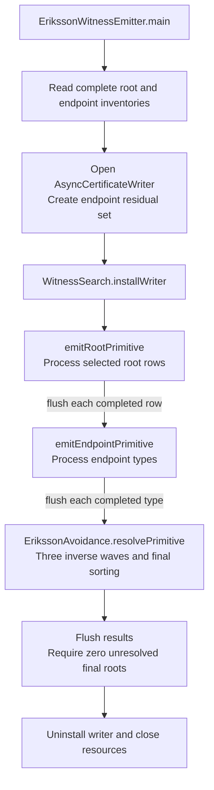

Each phase uses callbacks: the generator owns enumeration; the coordinator
supplies what to do with a generated pair. `settle(pair, budget, ...)` is the
ordinary discharge callback. Reconstruction instead supplies separate lookup,
CPU, GPU and persistence-barrier callbacks to `ErikssonAvoidance`.

An emission completion message reports its requested scope. Independent checking
is still needed, even when every search callback reports success.

## 2. Root generation hands only direct obligations to sorting

`emitRootPrimitive()` reads the row's complete counts. A published zero-direct
row is skipped for emission scheduling. The checker independently regenerates
that row; the skip is not proof that the generator would find nothing.

For a nonzero row,
[ErikssonRootGenerator](../emitter/src/main/java/br/unb/cic/td20/joint/ErikssonRootGenerator.java)
starts bounded parallel rank-placement tasks. Prefix state contains partial
positions, algebraic images, target edges and precomputed move predicates.

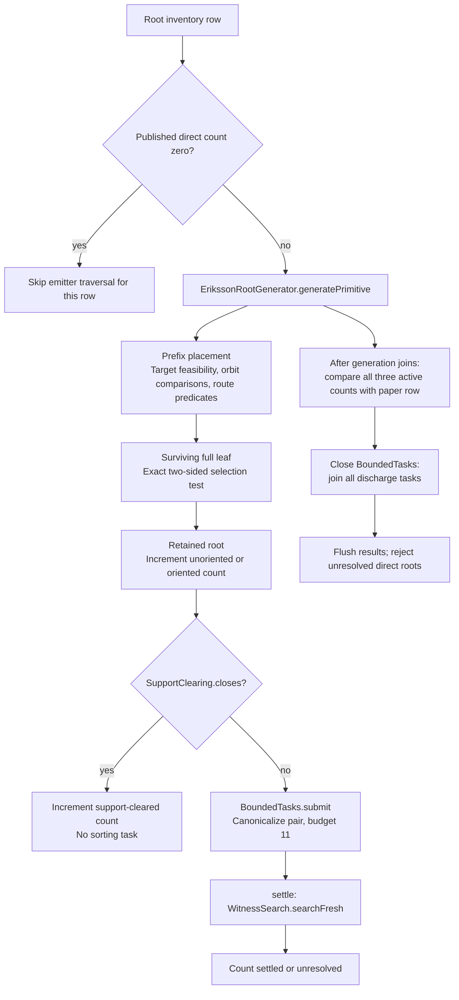

The exact selection test covers immediate gains on either endpoint, every
gain-zero/one first move, the required second moves and every eligible third
move. Prefix rejections can recognize some of these routes earlier; the final
leaf test handles the remaining two-sided possibilities.

[SupportClearing](../emitter/src/main/java/br/unb/cic/td20/joint/SupportClearing.java)
is a separate retained-root filter. Its allowed powers are precisely
9:7, 11:6, 13:7/10/11 and 17:9/13/15. The generator's counts include those
cleared roots; the callback keeps them out of the sorting queue. The row
comparison checks retained unoriented, retained oriented and support-cleared
counts, rather than comparing only their final difference.

Root representatives are unique within their type but use a different minimum
from certificate keys. `canonicalRepresentative()` resolves that difference
before `searchFresh()`.

## 3. Endpoint generation classifies every emitted representative

`readEndpointWork()` reads the complete published endpoint table and associates
each count with its independently constructed annotated type.
`emitEndpointPrimitive()` skips zero-count types and types with an elementary
closure. Other types use the direct twisted-bracelet generator.

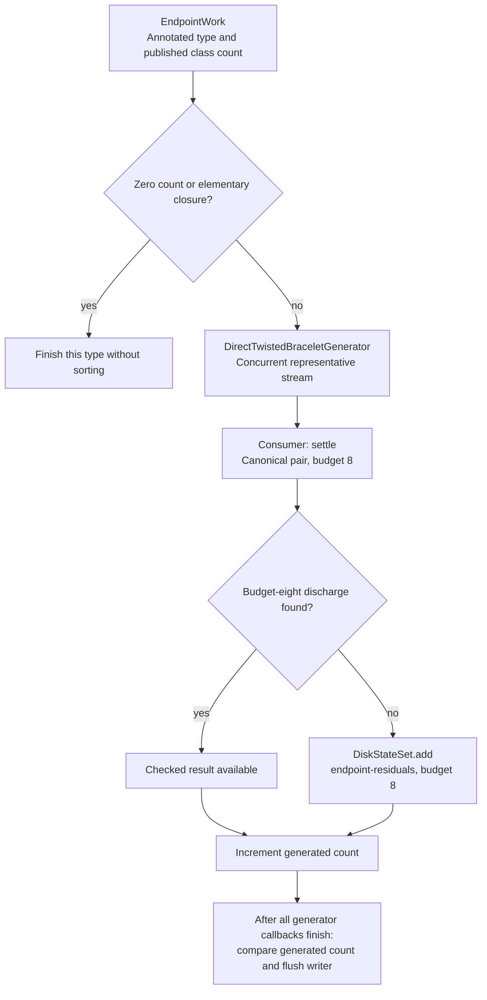

During ordinary emission, the unique generated class is searched directly; a
preliminary database lookup would duplicate work on every class. If an optional
`ReadOnlyWitnessSource` is supplied, `settle()` can replay and reuse a compatible
result before searching.

When running avoidance from existing results, endpoint generation still occurs,
but `settle()` checks the current database without launching ordinary endpoint
sorting. Its misses rebuild the endpoint residual set. A stored obstruction
marker is not used to decide whether to enumerate an endpoint.

Source anchors:
[DirectTwistedBraceletGenerator](../emitter/src/main/java/br/unb/cic/td20/bracelet/DirectTwistedBraceletGenerator.java),
[ReadOnlyWitnessSource](../emitter/src/main/java/br/unb/cic/td20/certificate/ReadOnlyWitnessSource.java),
[DiskStateSet](../emitter/src/main/java/br/unb/cic/td20/avoidance/DiskStateSet.java).

## 4. One sorting obligation: CPU, CUDA, replay, writer

[WitnessSearch](../emitter/src/main/java/br/unb/cic/td20/search/WitnessSearch.java)
is the boundary between search results and persisted certificates. Searchers
return a candidate result; Java replay checks it before the writer accepts it.

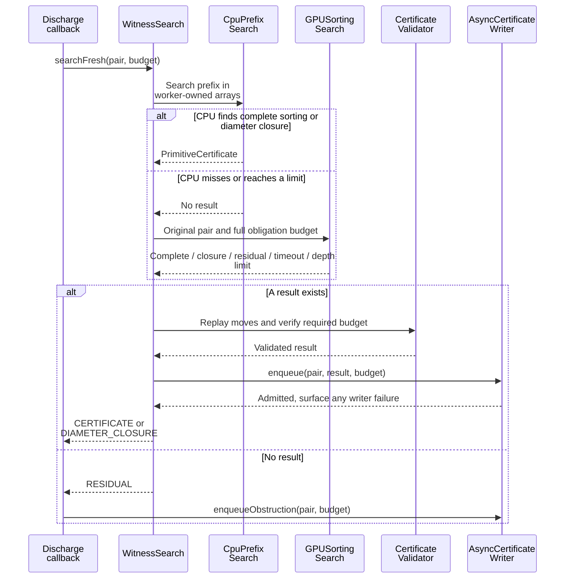

[CpuPrefixSearch](../emitter/src/main/java/br/unb/cic/td20/search/CpuPrefixSearch.java)
performs recursive apply/rollback search in a thread-local workspace. It tests
identity and known-diameter closure of the actual remaining nonfixed domain.
Depth, triple-count and time limits bound this heuristic. A CPU miss sends the
**original obligation** to the GPU; the prefix is not charged as completed work
and its last visited state is not the GPU's starting point.

Direct search defaults to a CPU prefix depth of three; reconstruction's
`searchCpuMiss()` supplies a default depth of five. Effective settings can
override depth. These heuristic depths differ from the full obligation budget.

`searchFresh()` omits stored-result lookup. General `search()` can replay an
existing result first. Reconstruction uses `lookupPrimitiveBatch()` before CPU
work and then `searchCpuMiss()` / `searchGpuMiss()`, which avoid repeating that
lookup. GPU-only callbacks also avoid rerunning the CPU prefix.

The writer's admission is asynchronous. It does not mean the result is durable
on disk yet; explicit phase flushes establish that boundary.

Inside the CPU prefix, the reusable `Workspace` owns one mutable `omega` vector,
a `beta` order per depth, and a packed move stack. The recursive interaction is:

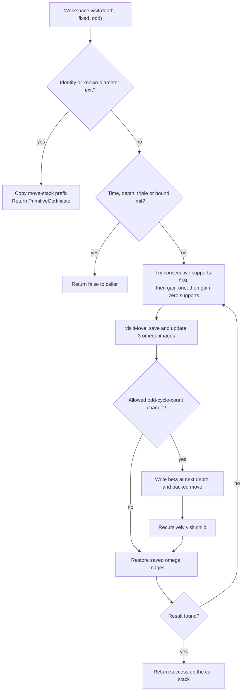

The parent `beta` remains in its depth row while the child uses the next row.
Restoring the three changed images makes the next support start from the same
parent. If all permitted supports finish without a result, `visit()` returns
false. No intermediate workspace state is persisted as a successful result.

## 5. Inside the GPU handoff

Java's
[GPUSortingSearch](../emitter/src/main/java/br/unb/cic/td20/base/GPUSortingSearch.java)
owns a bounded pending-search queue and a worker per configured device slot.
`GpuDeviceLayout` maps slots to devices. The first GPU search initializes the
native resources; successful CPU-only work does not initialize CUDA.

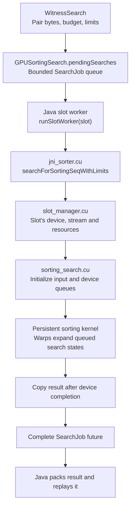

Within a slot, the kernel moves through queued tree states. It uses cooperative
warp copies, local/overflow queues, outstanding-work accounting and a bounded
state/depth cache. A found sorting or known-diameter closure returns a move
sequence. Queue overflow is an error. Time/depth limits and exhaustion of the
restricted tree return a miss, which leaves the obligation unresolved.

The persistent kernel's work cycle is different from the CPU call stack:

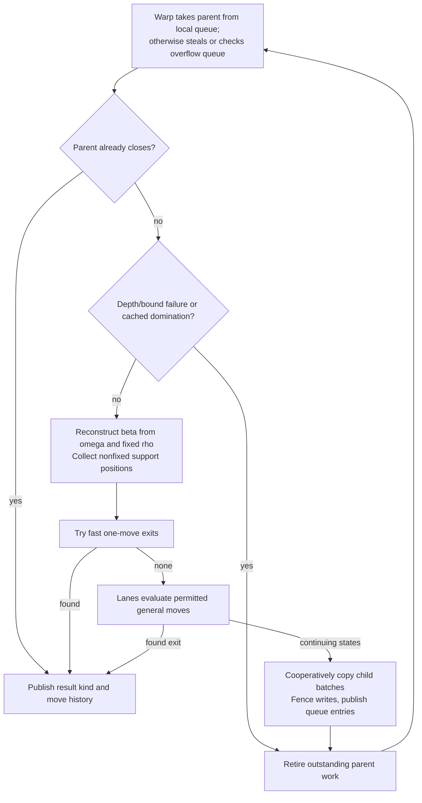

Some exits also occur during initial queue seeding. A warp with no available
parent waits or steals while outstanding work remains; zero outstanding work
ends the search. The target is fixed for a slot's search, so queued states can
store algebraic images and reconstruct the current cycle when needed. The
cache compares full state keys and depths; collisions or full probe sequences
fall back to exploration. The immediate inverse-move skip removes adjacent
undo operations. These optimizations belong inside a search, not to global
class deduplication or inverse-wave coverage.

The CUDA tree excludes fixed-symbol supports and supports meeting three distinct
algebraic cycles, and permits odd-length-cycle-count increases zero or two. The
CPU prefix permits the three-distinct-cycle case when that increase is zero.
Therefore GPU exhaustion is not a lower-bound certificate. Native positional
triples are converted to symbol moves before Java certificate replay.

Final-root searches use full depth 11 without a time cutoff. Intermediate GPU
searches use the actual budget, with an optional configured time limit. Advisory
prefetch uses a positive time slice and is followed by the mandatory final scan.

Source anchors:
[GpuDeviceLayout](../emitter/src/main/java/br/unb/cic/td20/base/GpuDeviceLayout.java),
[jni_sorter.cu](../emitter/src/native/jni/jni_sorter.cu),
[slot_manager.cu](../emitter/src/native/backtracking/slot_manager.cu),
[sorting_search.cu](../emitter/src/native/backtracking/sorting_search.cu).

## 6. Reconstruction separates lookup, CPU, GPU and inverse workers

[ErikssonAvoidance](../emitter/src/main/java/br/unb/cic/td20/avoidance/ErikssonAvoidance.java)
owns the three wave transitions.
[ReconstructionPipeline](../emitter/src/main/java/br/unb/cic/td20/avoidance/ReconstructionPipeline.java)
classifies scanned after-two sources, and later processes the final roots.
The GPU worker never performs the inverse callback itself.

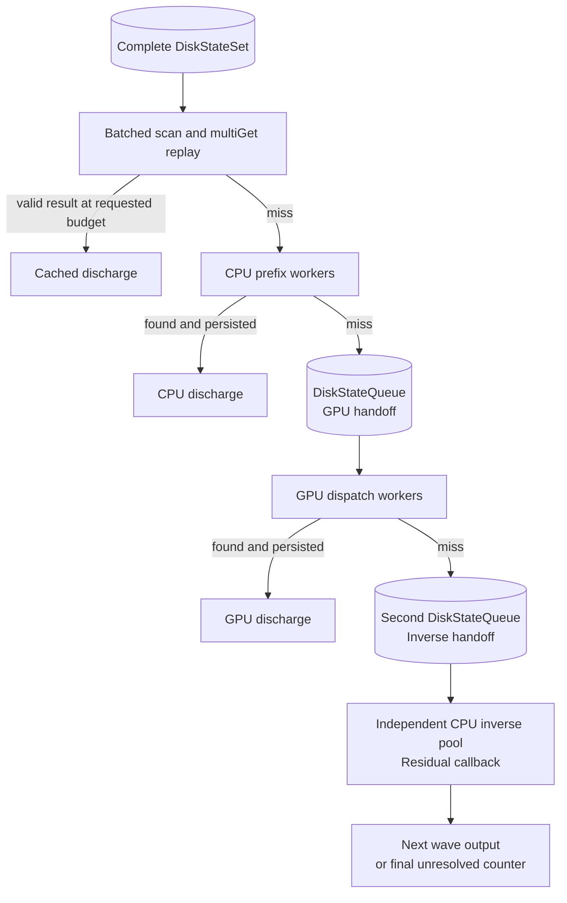

At the end, every pool joins and both queues drain. The pipeline checks:

```text
lookup hits + CPU discharges + GPU submissions = scanned source classes
GPU discharges + inverse submissions          = GPU submissions
completed inverse callbacks                   = inverse submissions
```

These equalities account for work classification. They do not count distinct
output classes; scratch persistence performs that deduplication.

## 7. The three inverse waves and their different consumers

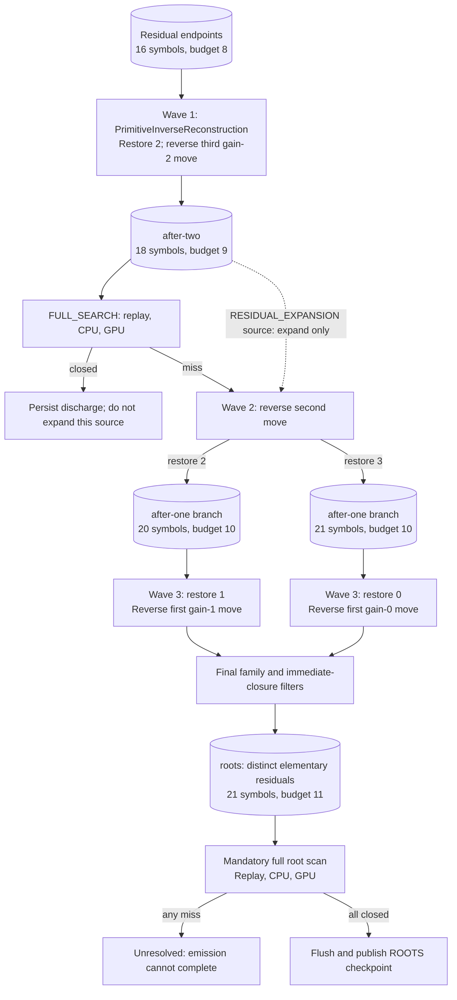

Every inverse generator covers both endpoints and every required support/gap
choice.
[PrimitiveInverseReconstruction](../emitter/src/main/java/br/unb/cic/td20/avoidance/PrimitiveInverseReconstruction.java)
uses worker-owned restored-domain arrays and emits borrowed raw arrays. Accepted
parents pass actual forward-gain and pair checks before persistence.

Fresh reconstruction uses `FULL_SEARCH` at after-two. A compatible completed
`RESIDUAL_EXPANSION` checkpoint identifies already selected source work and uses
`expandOnly()` there. These modes have different source meanings and cannot be
silently interchanged.

**Both modes expand every after-one source.** There is no budget-ten lookup or
sorting stage that removes sources before the final inverse wave. The combined
budget-ten set is drained and counted exactly with `countKeys()` before final
generation begins.

## 8. How the final wave avoids materializing elementary parents

The final-wave call is `DiskStateSet.addFinalInverseGenerated()`. It connects
three components in this order:

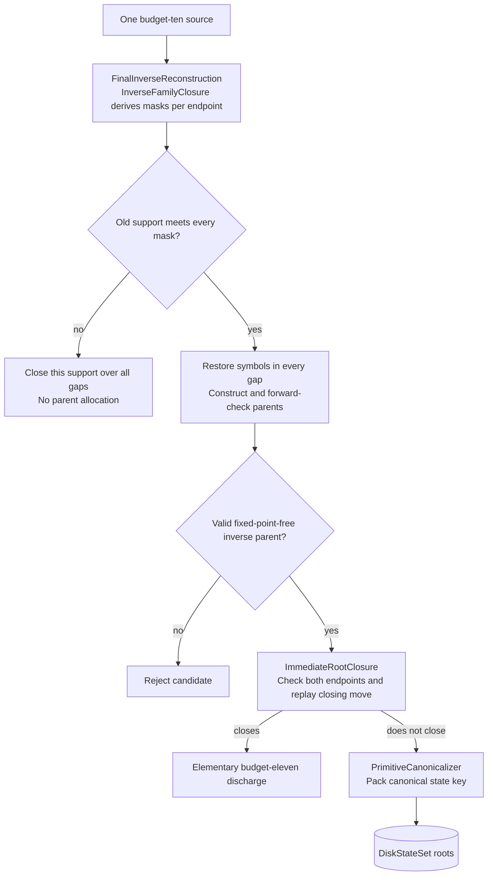

The family test occurs **before gap expansion**. If no old support of the
required size can meet all masks, it closes the whole source-endpoint family.
Otherwise only the supports meeting every mask reach explicit parent generation.
Passing that filter is not evidence that a parent needs sorting: the subsequent
two-sided immediate test can still close it.

The following is a schematic mask graph, not a recorded source fixture. It
illustrates the software's support classification for a gain-one inverse,
whose old support has size two.

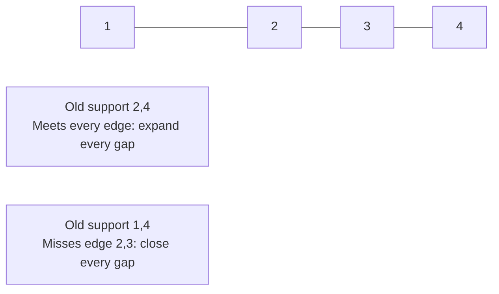

Both endpoint branches build masks from the actual source. Canonicalization
happens only after validity and individual immediate closure have been decided.
The resulting set is exactly the final residual inventory specified in the
paper; it is not an empirically selected list of difficult cases.

Source anchors:
[FinalInverseReconstruction](../emitter/src/main/java/br/unb/cic/td20/avoidance/FinalInverseReconstruction.java),
[InverseFamilyClosure](../emitter/src/main/java/br/unb/cic/td20/avoidance/InverseFamilyClosure.java),
[ImmediateRootClosure](../emitter/src/main/java/br/unb/cic/td20/avoidance/ImmediateRootClosure.java).

## 9. Output persistence, prefetch and completion barriers

Inverse callbacks pack keys into per-producer buffers. `DiskStateSet` routes
batches by deterministic hash to
[StateSetWriter](../emitter/src/main/java/br/unb/cic/td20/avoidance/StateSetWriter.java)
shards. Each writer owns one bounded queue and propagates worker failures.
Its persistence callback sorts and deduplicates the shard buffer, builds an SST, then
ingests it into the scratch RocksDB set. Identical keys across SSTs remain one
logical entry. SST writing bypasses WAL; ordinary RocksDB writes disable WAL.

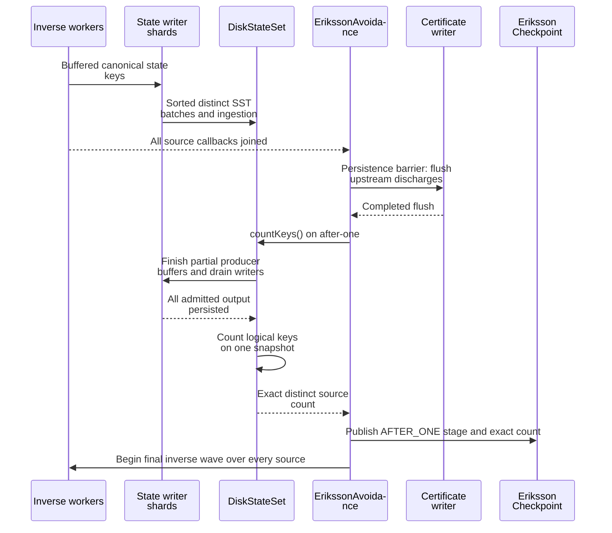

This sequence shows the after-one boundary. At the final-root boundary, the
mandatory processing scan establishes the exact root count while checking
every root. Its workers join and certificates flush before the `ROOTS` checkpoint
is published. A failed writer or flush prevents advancing the checkpoint.

[RootPrefetch](../emitter/src/main/java/br/unb/cic/td20/avoidance/RootPrefetch.java)
overlaps final generation with early root lookups and searches. Generated root
key batches also enter a bounded advisory queue: multiGet replay first, CPU
misses next, and only remaining misses reach sliced GPU search. Queue pressure
can discard advisory work without blocking generation. Every distinct persisted
root is processed again by the mandatory scan, so discarded or suppressed
prefetch occurrences cannot omit obligations.

[AsyncCertificateWriter](../emitter/src/main/java/br/unb/cic/td20/certificate/AsyncCertificateWriter.java)
has a separate bounded queue for intrinsic results. Its write batches update
witness and obstruction families, WAL is disabled, and explicit `flush()` drains
admitted work and flushes the database. Background writes alone are not a
completed durability boundary. `enqueue()` also replays an incoming result
before encoding it, including results arriving through optional import paths.

[ErikssonCheckpoint](../emitter/src/main/java/br/unb/cic/td20/avoidance/ErikssonCheckpoint.java)
validates stage, mode, route, budgets, inventory kind and counts on resume.
An interrupted output wave is regenerated from its completed source boundary.
A supported older completed after-one checkpoint with a pending count is counted
and upgraded before final expansion. Old complete-root, incompatible-mode or
historical TD18 checkpoints cannot be relabeled as current filtered roots.

Generated/submitted/ingested counters can contain duplicate key occurrences.
Final expansion progress uses completed sources against the exact after-one
source total; the exact distinct output-root count is unknown until the mandatory
scan completes.

## 10. Optional result reuse and database maintenance

These components prepare or reuse intrinsic results around the main execution.
They do not replace the checker's regeneration.

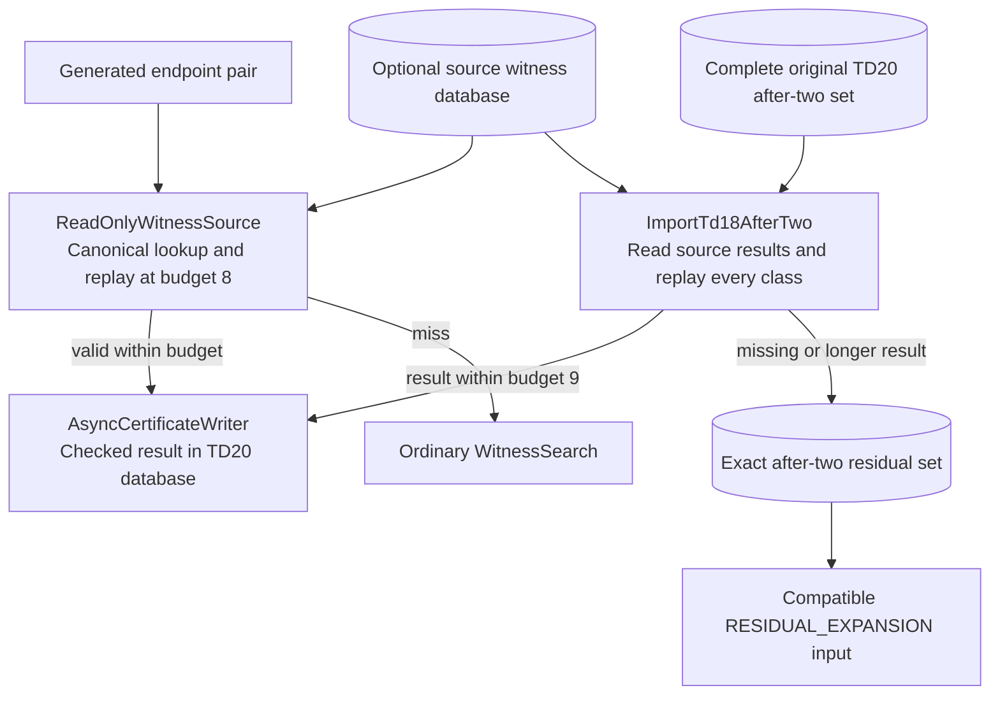

Despite its name,
[ImportTd18AfterTwo](../emitter/src/main/java/br/unb/cic/td20/avoidance/ImportTd18AfterTwo.java)
requires the complete **TD20** after-two source inventory and compatible TD20
checkpoint. It imports replayed intrinsic witnesses from the source database,
not an archived TD18 reconstruction checkpoint. It checks source/imported/
residual accounting, flushes copied results, seals residuals, rechecks destination
coverage, then publishes its residual work and report.

[CertificateDatabaseMerger](../emitter/src/main/java/br/unb/cic/td20/certificate/CertificateDatabaseMerger.java)
opens one input database at a time, submits bounded record batches for replay,
and routes accepted results through `AsyncCertificateWriter`. Every duplicate
witness is replayed too. It joins and flushes each input before opening the next,
so unique-result counting does not depend on asynchronous write timing. Source
advisory markers are validated and omitted from the imported marker stream.

[CertificateDatabaseConsolidator](../emitter/src/main/java/br/unb/cic/td20/certificate/CertificateDatabaseConsolidator.java)
copies opaque key/value records from disjoint closed emission databases into
sorted SSTs, ingests and compacts them, and checks input/output inventories before
publishing the result. It preserves witness and marker families and explicitly
records `replay=none`. This differs from the merger's replay path. Both tools
produce database-maintenance reports; the independent checker supplies complete
proof verification.
