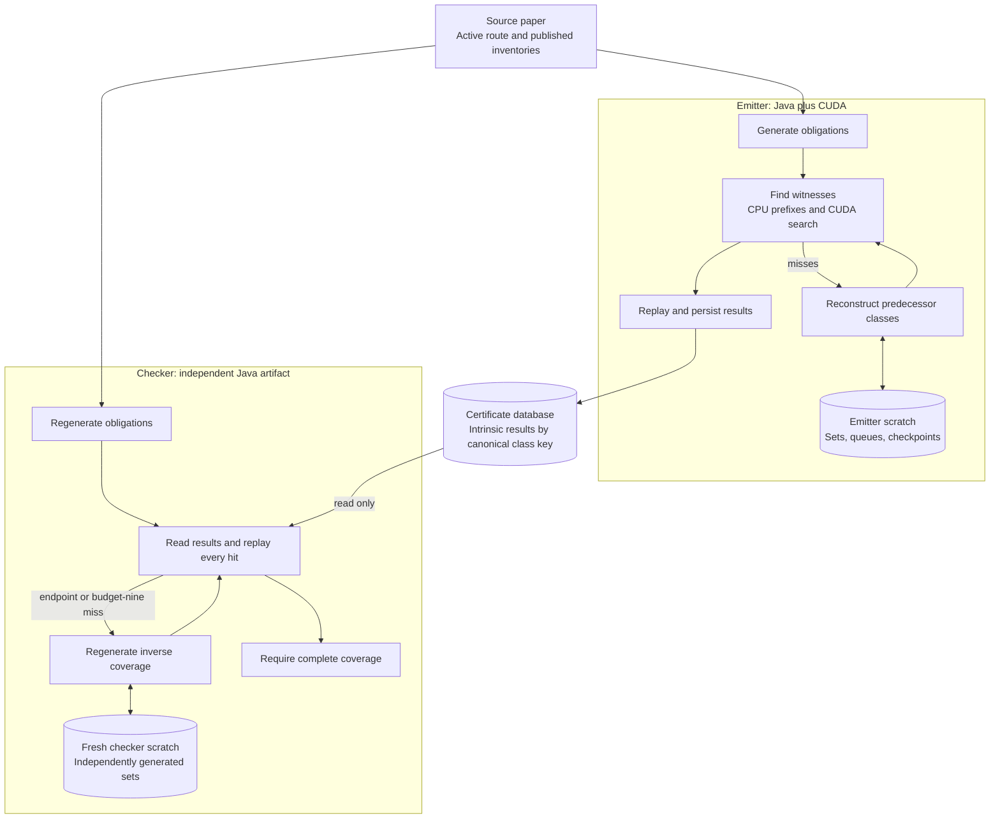
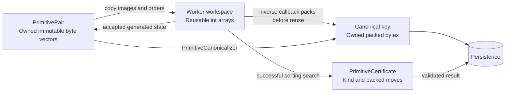
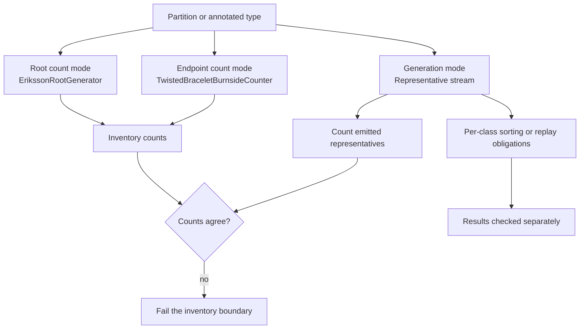
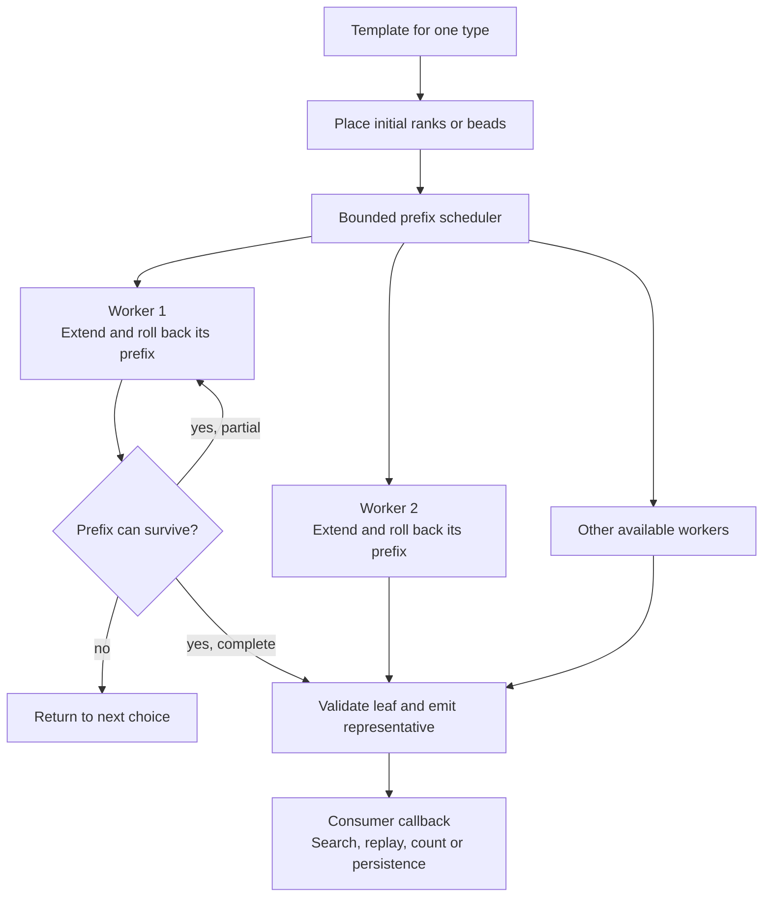
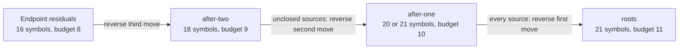

# Visual guide to internal execution

This guide assumes familiarity with the project's mathematics and explains how
the software implements it: which components do the work, what they pass to each
other, and when execution can advance. It describes the active production route;
the [source paper](td20-reduction-count.tex) remains authoritative for the proof.

Read the diagrams here first, then follow the
[emitter walkthrough](EMITTER_EXECUTION.md) and
[checker walkthrough](CHECKER_EXECUTION.md). Each walkthrough follows execution
through the main classes, rather than describing how to launch the applications.

## 1. The two applications and their connecting artifact

The emitter **finds and stores results**. The checker **regenerates the work and
checks stored results**. The certificate database is their connecting artifact.
Their scratch databases serve different executions and are not transferred as
proof inputs.

The loop represents work moving between phases, not recursive calls to the
whole application. A residual endpoint produces after-two work; residual
after-two work produces the remaining inverse waves. A final-root miss stops
completion. The detailed diagrams distinguish those cases.

The Maven modules contain their own implementations of the model, generator,
counter, moves, codec and validator. Identical class names in `emitter/` and
`checker/` refer to classes compiled into different artifacts.
[checker/pom.xml](../checker/pom.xml) has no emitter dependency. The checker
does not call CUDA or search for replacement witnesses.

## 2. What actually travels between components

The production representation is compact. Most hot loops use primitive arrays,
not collections of `Cycle` objects. The mathematical object APIs remain useful
for comparison tests.

| Object or representation | What a component receives | Where it is used |
| --- | --- | --- |
| `PrimitivePair` | `omega` successor images, `beta` and `rho` cyclic orders, fixed-symbol mask, cached canonical data. | Generation output, search input, certificate replay and decoded state scans. |
| Worker-owned `int[]` arrays | Mutable copies, positions, successors and temporary move state. | Recursive CPU search, inverse enumeration, canonical comparisons and replay. |
| Borrowed inverse output arrays | A view valid only during the callback. The consumer packs the key before the worker reuses the arrays. | Large inverse waves; avoids allocating a pair per candidate. |
| `PrimitiveCertificate` | `COMPLETE` or `DIAMETER_CLOSURE`, plus packed symbol triples. | CPU/CUDA results, imports, persistence and checker replay. |
| Emitter `DiskStateSet.State` / checker `SearchState` | Pair plus explicit `maximumMoves`. | Scratch scans and phase-specific obligations. |
| Canonical certificate key | Five bits per algebraic image after class canonicalization and normalization of `beta`. | Witness lookup and storage. |
| Scratch state key | Version, budget, domain size, then canonical pair bytes. | Deduplication and validation of inverse inventories. |

A pair and its budget travel together through reconstruction. The same domain
can occur at different budgets: a 21-symbol after-one source has budget 10,
while a 21-symbol final root has budget 11. The scratch key preserves this
distinction. An intrinsic certificate key identifies the class; replay determines
whether its result meets the requested budget.

Source anchors: emitter
[PrimitivePair](../emitter/src/main/java/br/unb/cic/td20/model/PrimitivePair.java),
[PrimitiveCanonicalizer](../emitter/src/main/java/br/unb/cic/td20/model/PrimitiveCanonicalizer.java),
[PrimitiveCertificate](../emitter/src/main/java/br/unb/cic/td20/certificate/PrimitiveCertificate.java),
[CertificateCodec](../emitter/src/main/java/br/unb/cic/td20/certificate/CertificateCodec.java);
checker [SearchState](../checker/src/main/java/br/unb/cic/td20/verification/SearchState.java).

## 3. Generation and counting are separate computations

`CountEriksson` coordinates census work. `ErikssonRootGenerator` counts retained
root categories during traversal. Endpoint counting uses
`TwistedBraceletBurnsideCounter`, reached through the generator's counting API.
Counting produces inventory records, not sorting results.

Both generators split partial placements into independent prefix tasks. Each
worker extends its own mutable traversal state and rolls it back when returning
from a branch. Early rejections remove impossible targets, duplicate orbit
images, or roots already covered by the active reduction. They do not build a
global in-memory list of all permutations first.

The diagram abbreviates the same traversal inside each worker.
`DirectTwistedBraceletGenerator` keeps content, auxiliary color/rank
standardization, twisted rotation/reflection comparisons, orientation constraints
and target arcs in its traversal state. Its primitive output avoids constructing
an `EncodingWord` and then decoding that object.

**Two representative conventions coexist deliberately.** Root generation
minimizes normalized image vectors. Certificate canonicalization minimizes the
auxiliary encoding word. Consequently, root `generatePrimitive()` creates a
pair with `canonical=false`; the consumer requests its certificate canonical
representative before lookup or sorting. Endpoint direct generation already
minimizes the auxiliary word and can emit `canonical=true`. Unique generation
within a type does not make these two minima interchangeable.

The general APIs distinguish unchecked
[CyclicTargetCandidate](../emitter/src/main/java/br/unb/cic/td20/model/CyclicTargetCandidate.java)
from a validated
[CyclicTargetPair](../emitter/src/main/java/br/unb/cic/td20/model/CyclicTargetPair.java).
Candidate-orbit comparisons use
[TwistedBraceletKey](../emitter/src/main/java/br/unb/cic/td20/model/TwistedBraceletKey.java);
valid-pair classes use
[ExtendedToricClassKey](../emitter/src/main/java/br/unb/cic/td20/model/ExtendedToricClassKey.java).
Primitive production paths implement the same boundaries directly in arrays.
Fixed points are contracted before a fixed-point-free generator or inverse
workspace accepts the state.

Source anchors: emitter
[CountEriksson](../emitter/src/main/java/br/unb/cic/td20/CountEriksson.java),
[ErikssonRootGenerator](../emitter/src/main/java/br/unb/cic/td20/joint/ErikssonRootGenerator.java),
[DirectTwistedBraceletGenerator](../emitter/src/main/java/br/unb/cic/td20/bracelet/DirectTwistedBraceletGenerator.java),
[TwistedBraceletBurnsideCounter](../emitter/src/main/java/br/unb/cic/td20/bracelet/TwistedBraceletBurnsideCounter.java);
checker
[CountEriksson](../checker/src/main/java/br/unb/cic/td20/CountEriksson.java) and
[ErikssonRootGenerator](../checker/src/main/java/br/unb/cic/td20/joint/ErikssonRootGenerator.java).

## 4. The phase names on disk

The names refer to positions in the forward route. Execution reconstructs them
in the opposite direction. Neither `after-two` nor `after-one` means the second
or first inverse wave.

| Artifact | Owner and content | Completion boundary |
| --- | --- | --- |
| Certificate database | Emitter writes version-2 intrinsic results; checker opens read only. Default family holds results and schema marker; `obstructions` holds advisory misses. | Explicit writer flushes at completed persistence boundaries. |
| `endpoint-residuals` | Each application derives its own missing budget-eight endpoint discharges. | Generation/replay finished, writers drained, exact set sealed. |
| `after-two` | Distinct reconstructed budget-nine classes. | Complete third-move inverse generation. |
| `after-two-residuals` | Checker-only set of after-two classes not closed by replay at budget nine. | Every after-two class classified. |
| `after-one` | Distinct budget-ten sources from both second-move inverse branches. | All required sources expanded and all output writers drained. |
| `roots` | Distinct final residual classes outside elementary immediate closures. | Final generation complete, then exhaustive budget-eleven processing. |
| Disk queues | Emitter's CPU-to-GPU and GPU-to-inverse handoffs. They carry work occurrences, not deduplicated class inventories. | Producers finish, consumers drain, counts reconcile. |
| `ErikssonCheckpoint` | Emitter-only versioned stage, mode, route, budgets and counts. | A compatible completed boundary; not a checker proof input. |
| `inverse-coverage-v3.txt` | Checker output summarizing independently regenerated coverage. | Final replay complete with no unresolved class. |

Scratch sets use version-three state keys. Current filtered final-root emitter
checkpoints use `td-eriksson-reconstruction-v4` and
`rootInventory=ELEMENTARY_RESIDUALS`. These version numbers describe different
formats; they are not competing versions of the same file.

## 5. Components around the main execution

| Component group | Role in the codebase | Relationship to the active run |
| --- | --- | --- |
| `joint/ErikssonRoute`, `ErikssonInventory`, `KnownDiameters`, `SupportClearing` | Route constants, inventory loading, bound table and explicit clearing patterns. | Used throughout generation, phase validation and closure checks. |
| `reduction/Partitions`, `AnnotatedPartitions` | Build partition and orientation inventories. | Supply the 83 root partitions and 143 endpoint annotations. |
| `permutation/` and `search/CommonOperations` | General permutation and transposition operations. | Mathematical APIs, compatibility paths and independent comparison oracles; primitive hot loops use arrays. |
| `runtime/BoundedTasks` | Worker pools, bounded submission and failure propagation. | Limits queued work while independent producers and consumers run concurrently. |
| Checker `CheckerParallelism`, `RocksDbMemoryBudget` | Worker/read limits and shared native memory allocation. | Configure generation, reads, replay, scans and scratch storage. |
| Progress classes and CPU/GPU statistics | Observe phases, completed source work, queues, memory and rates. | Default ten-second snapshots; output occurrences are separate from exact distinct inventories. |
| Emitter `ReadOnlyWitnessSource`, `ImportTd18AfterTwo` | Replay reusable results and convert compatible imported classes. | Optional input preparation; only replayed, budget-valid TD20 results discharge current obligations. |
| Emitter `CertificateDatabaseMerger`, `CertificateDatabaseConsolidator` | Merger replays incoming results; consolidator copies opaque records from disjoint closed databases and checks inventories. | Artifact maintenance, outside the main generation/reconstruction loop; consolidation does not replay witnesses. |

The walkthroughs link the participating classes at each phase. For the broader
design rationale see [ARCHITECTURE.md](ARCHITECTURE.md); for validation scopes
see [VALIDATION.md](VALIDATION.md).

## 6. Relating execution to the completed record

The diagrams explain current code behavior. The completed proof evidence belongs
to the computation recorded in [REFERENCE_SIMULATION.md](REFERENCE_SIMULATION.md):
`checker-20261122T183611Z-32945`, completed on 22 November 2026. Its independently
regenerated inventories were:

| Boundary | Recorded distinct classes |
| --- | ---: |
| Residual endpoints | 2,036 |
| After-two | 5,032,950 |
| After-two closed by budget-nine replay | 4,062,619 |
| After-two residuals | 970,331 |
| After-one sources | 4,010,256,622 |
| Final residual roots | 51,456,682 |
| Unresolved final roots | 0 |

These are recorded outcomes, not constants used to decide which residual
classes to generate. Both inverse endpoints and both branches remain mandatory.
The [evidence ledger](RESEARCH_PLAN.md) records the separate count, test and
full-check scopes.
